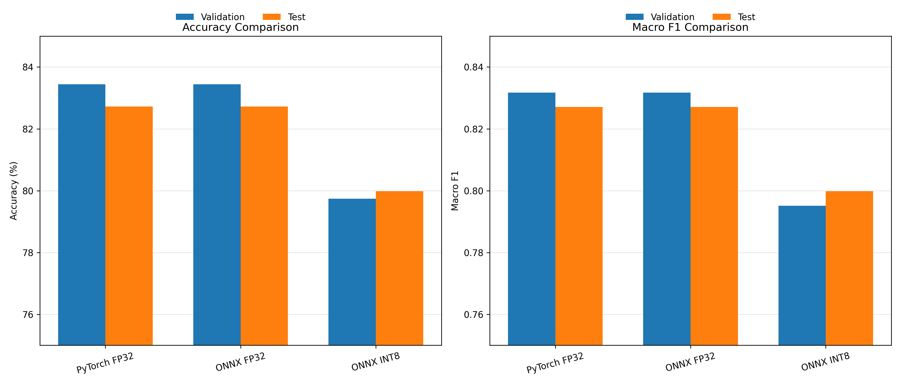
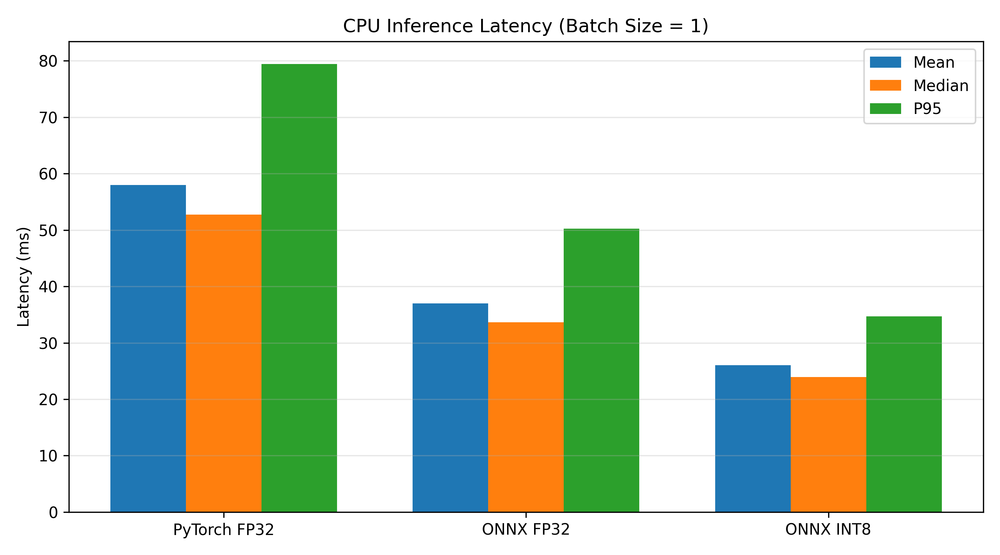
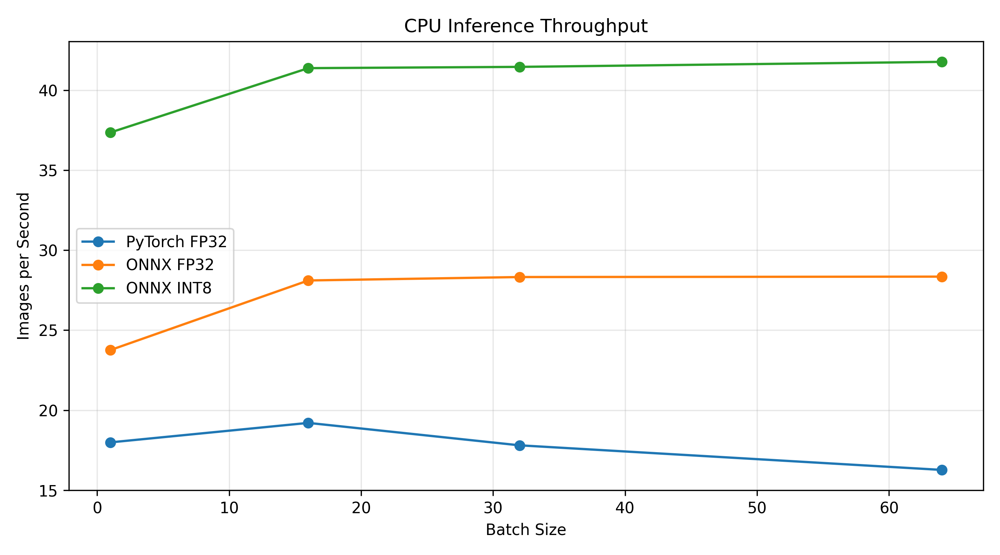
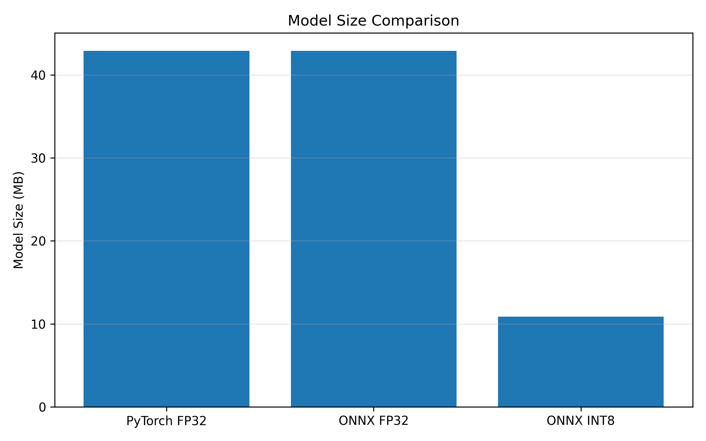
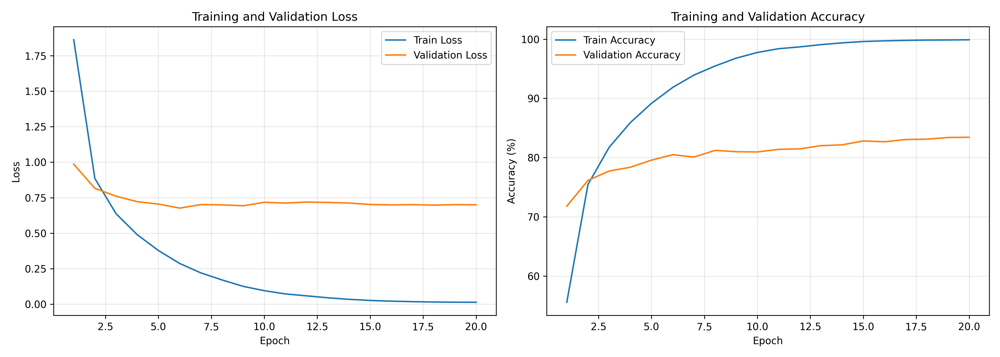

# ResNet18 ONNX Quantization

A deep learning inference optimization project comparing **PyTorch FP32**, **ONNX FP32**, and **ONNX INT8** models on CIFAR-100.

The goal is to evaluate how ONNX conversion and INT8 quantization affect model accuracy, inference latency, throughput, and model size.

## Project Overview

In this project, a pretrained ResNet18 model was fine-tuned on CIFAR-100 and converted into ONNX format. Static INT8 quantization was then applied to optimize CPU inference performance.

The three model versions were evaluated using the same test dataset and CPU benchmarking setup.

**Key results:**

- ONNX FP32 achieved the same accuracy as the original PyTorch FP32 model.
- ONNX INT8 reduced model size by approximately **74.67%**.
- ONNX INT8 achieved **2.21× lower median latency** compared with PyTorch FP32.
- ONNX INT8 achieved approximately **2.57× higher throughput** at batch size 64 compared with PyTorch FP32.
- INT8 quantization introduced a test accuracy decrease of approximately **2.74 percentage points**.

## Tech Stack

- Python
- PyTorch
- Torchvision
- ONNX
- ONNX Runtime
- ONNX Runtime Quantization
- NumPy
- Pandas
- Scikit-learn
- Matplotlib

## Model Training

**Dataset:** CIFAR-100

**Architecture:** ResNet18 (pretrained backbone)

**Training configuration:**

| Parameter | Value |
|---|---|
| Training samples | 45,000 |
| Validation samples | 5,000 |
| Test samples | 10,000 |
| Input resolution | 224 × 224 |
| Batch size | 64 |
| Optimizer | AdamW |
| Learning rate | 0.0001 |
| Weight decay | 0.00001 |
| Scheduler | Cosine Annealing |
| Epochs | 20 |
| Best validation accuracy | 83.44% |

The pretrained ResNet18 classification head was replaced with a 100-class output layer.

The best checkpoint was selected based on validation accuracy.

## ONNX Conversion

The trained PyTorch model was exported to ONNX using:

- ONNX opset version 18
- Dynamic batch dimensions
- CPU inference

The exported ONNX model was validated against the original PyTorch model.

**Numerical consistency check:**

| Metric | Result |
|---|---:|
| Maximum absolute difference | 0.00000381 |
| Mean absolute difference | 0.00000096 |
| Prediction agreement | 100% |

These results confirm that the ONNX FP32 model closely reproduces the original PyTorch model's outputs.

## INT8 Quantization

Static quantization was applied using ONNX Runtime.

**Quantization configuration:**

| Parameter | Value |
|---|---|
| Quantization method | Static |
| Quantization format | QDQ |
| Weight type | INT8 |
| Activation type | UINT8 |
| Calibration method | MinMax |
| Per-channel quantization | Enabled |
| Calibration batches | 16 |
| Calibration dataset | Validation set |

The validation dataset was used for calibration. Final model performance was evaluated separately on the test dataset.

## Evaluation Results

### Test Set Performance

| Model | Accuracy | Macro F1 |
|---|---:|---:|
| PyTorch FP32 | 82.72% | 0.8271 |
| ONNX FP32 | 82.72% | 0.8271 |
| ONNX INT8 | 79.98% | 0.7998 |

INT8 quantization resulted in a 2.74 percentage-point decrease in test accuracy compared with FP32.

### Validation Set Performance

| Model | Accuracy | Macro F1 |
|---|---:|---:|
| PyTorch FP32 | 83.44% | 0.8317 |
| ONNX FP32 | 83.44% | 0.8317 |
| ONNX INT8 | 79.74% | 0.7951 |

### Accuracy and Macro F1 Comparison



## CPU Inference Latency

Latency was measured using batch size 1, with 50 warm-up iterations and 1,000 benchmark iterations.

| Model | Mean (ms) | Median (ms) | P95 (ms) |
|---|---:|---:|---:|
| PyTorch FP32 | 57.97 | 52.75 | 79.47 |
| ONNX FP32 | 36.98 | 33.64 | 50.26 |
| ONNX INT8 | 26.03 | 23.92 | 34.68 |

**Median latency speedup:**

- ONNX FP32 vs. PyTorch FP32: **1.57×**
- ONNX INT8 vs. ONNX FP32: **1.41×**
- ONNX INT8 vs. PyTorch FP32: **2.21×**



## CPU Throughput

Throughput was evaluated at batch sizes 1, 16, 32, and 64.

| Model | Batch Size | Throughput (images/sec) |
|---|---:|---:|
| PyTorch FP32 | 1 | 17.99 |
| PyTorch FP32 | 16 | 19.20 |
| PyTorch FP32 | 32 | 17.80 |
| PyTorch FP32 | 64 | 16.26 |
| ONNX FP32 | 1 | 23.76 |
| ONNX FP32 | 16 | 28.11 |
| ONNX FP32 | 32 | 28.32 |
| ONNX FP32 | 64 | 28.35 |
| ONNX INT8 | 1 | 37.36 |
| ONNX INT8 | 16 | 41.38 |
| ONNX INT8 | 32 | 41.46 |
| ONNX INT8 | 64 | 41.77 |

At batch size 64:

- ONNX FP32 achieved approximately **1.74×** the throughput of PyTorch FP32.
- ONNX INT8 achieved approximately **2.57×** the throughput of PyTorch FP32.
- ONNX INT8 achieved approximately **1.47×** the throughput of ONNX FP32.



## Model Size Comparison

| Model | Size |
|---|---:|
| PyTorch FP32 | 42.91 MB |
| ONNX FP32 | 42.90 MB |
| ONNX INT8 | 10.86 MB |

The ONNX FP32 size includes its external `.onnx.data` file.

INT8 quantization reduced the model size by approximately **74.67%**, resulting in a 3.95× smaller model.



## Training Curves



## Repository Structure

```text
resnet18-onnx-quantization/
│
├── notebooks/
│   └── resnet18_quantization.ipynb
│
├── src/
│
├── results/
│   ├── metrics.csv
│   ├── latency.csv
│   ├── throughput.csv
│   ├── model_size.csv
│   ├── training_history.csv
│   │
│   └── plots/
│       ├── training_curves.png
│       ├── accuracy_comparison.png
│       ├── latency_comparison.png
│       ├── throughput_comparison.png
│       └── model_size_comparison.png
│
├── models/
│
├── .gitignore
├── requirements.txt
└── README.md
```

## Key Takeaways

1. **ONNX conversion:** ONNX FP32 preserved the original PyTorch model's predictions and achieved identical evaluation metrics.
2. **INT8 quantization:** Static quantization significantly reduced model size and improved CPU inference performance.
3. **Accuracy trade-off:** INT8 quantization introduced a measurable but relatively limited accuracy decrease.
4. **Inference optimization:** ONNX Runtime provided better CPU inference performance than the PyTorch baseline in this benchmark.
5. **Deployment perspective:** INT8 quantization can be useful when inference speed and model size are important deployment constraints.

## Benchmark Notes

- All inference benchmarks were performed on CPU.
- Latency measurements used batch size 1.
- Throughput measurements used batch sizes 1, 16, 32, and 64.
- Benchmark timings include inference wrapper and input conversion overhead. They should not be interpreted as isolated kernel execution times.
- Results are hardware- and runtime-dependent. Comparisons are meaningful within the same benchmark environment.

## Future Improvements

- Compare additional quantization calibration methods.
- Evaluate dynamic quantization and alternative quantization configurations.
- Benchmark inference on different CPU architectures.
- Explore inference optimization using OpenVINO or other deployment runtimes.
